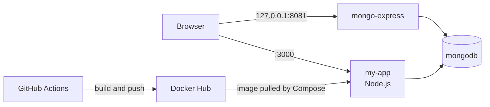
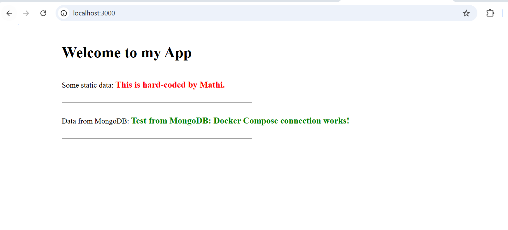
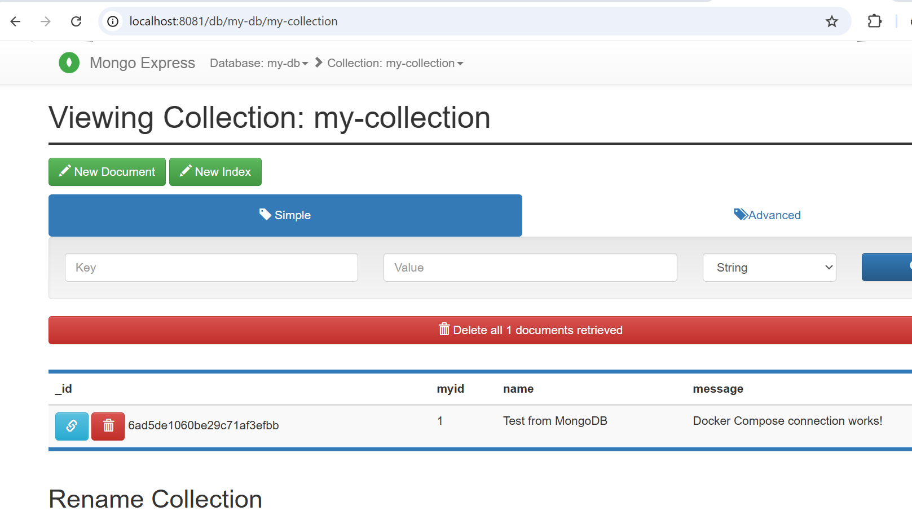
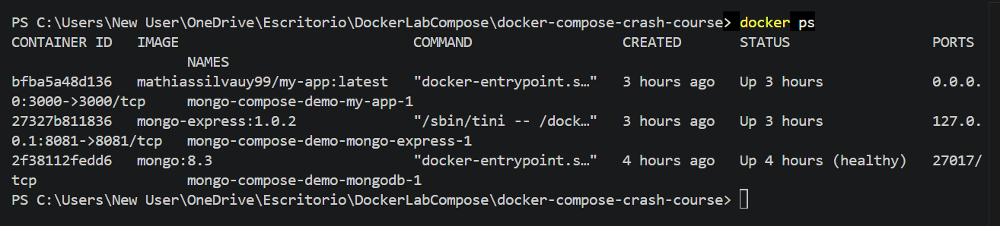
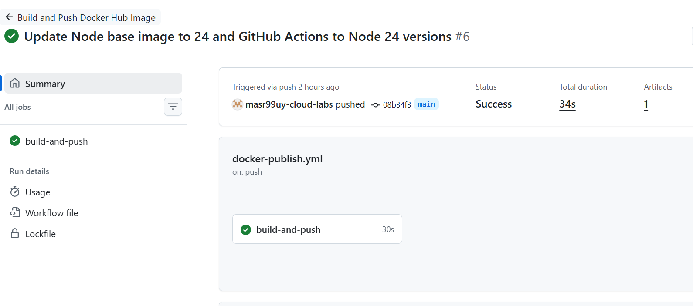
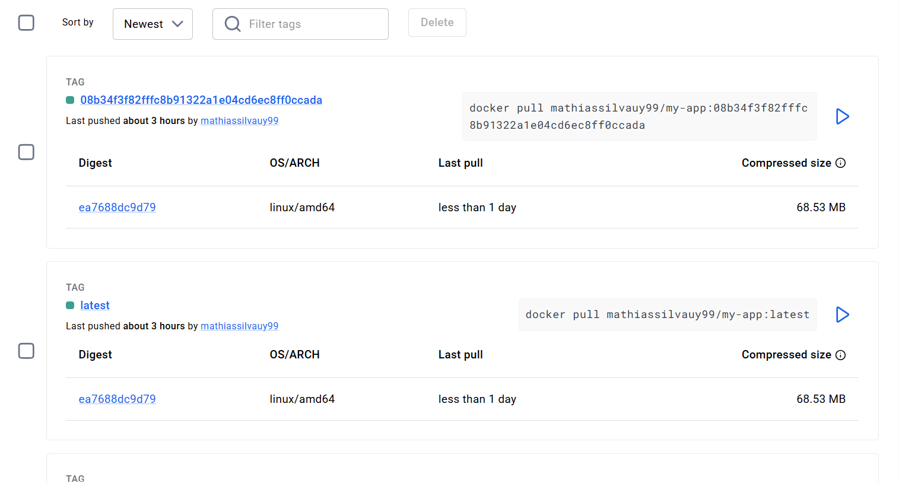

# Multi-Container App with Docker Compose and CI to Docker Hub

A small Node.js application that reads data from MongoDB, running as a multi-container setup with Docker Compose. A GitHub Actions workflow builds the application image and publishes it to Docker Hub on every relevant push to `main`.

> **Note:** Although I was familiar with Docker and had already done some practical work with it in the past, I started from scratch again to go over every detail.
>I built this project while learning Docker, following two YouTube courses
> ([Docker Crash Course](https://www.youtube.com/watch?v=pg19Z8LL06w), [Ultimate Docker Compose Tutorial](https://www.youtube.com/watch?v=SXwC9fSwct8&t=2072s)), and using AI assistants (ChatGPT, Claude) to improve my workflow and my docker compose, file clarify concepts, debug issues and draft documentation.
>
> The base setup (Node.js app + MongoDB + Mongo Express with Docker Compose) comes from
> the courses. What I added and configured myself:
> - GitHub Actions workflow that builds the image and publishes it to Docker Hub.
> - Credentials in a `.env` file instead of hardcoded values.
> - Healthchecks, a named volume for MongoDB data and pinned image versions.
> - Restricted ports (database not published, Mongo Express on localhost only).
> - Moved to a new Compose setup with a named volume and recreated the sample data after a failed backup restore.

## Architecture



| Service | Image | Purpose | Access |
|---|---|---|---|
| `my-app` | `mathiassilvauy99/my-app` (built from this repo) | Node.js app with a frontend and a backend API that reads from MongoDB | http://localhost:3000 |
| `mongodb` | `mongo:8.3` | Database | Internal only (not published to the host) |
| `mongo-express` | `mongo-express:1.0.2` | Web UI to inspect the database | http://localhost:8081 (localhost only) |

## CI: build and publish the image

The workflow in `.github/workflows/docker-publish.yml`:

- Runs on pushes to `main` that change `app/**`, the `Dockerfile` or the workflow itself.
- Logs in to Docker Hub using a **scoped access token** stored as a GitHub Actions secret (`DOCKERHUB_USERNAME`, `DOCKERHUB_TOKEN`).
- Builds the image with Docker Buildx and pushes it with two tags: `latest` and the commit SHA, so every build can be traced back to a commit.
- Uses minimal permissions (`contents: read`).

## Run it locally

Requirements: Docker and Docker Compose v2.

```bash
git clone https://github.com/masr99uy-cloud-labs/Lab-Docker-Workflow.git
cd Lab-Docker-Workflow

cp .env.example .env
# edit .env and set your own credentials

docker compose up -d
```

Then open:

- App: http://localhost:3000
- Mongo Express: http://localhost:8081 (use the basic-auth credentials from your `.env`)

Stop everything with `docker compose down` (add `-v` to also delete the database volume).

## Screenshots

**The app showing data read from MongoDB**


**Mongo Express inspecting the database**


**All three services running, MongoDB healthy**


**GitHub Actions workflow building and pushing the image**


**Image published on Docker Hub with the `latest` and commit SHA tags**


## Configuration

All credentials come from environment variables in a `.env` file, which is **not** committed. `.env.example` lists the variables you need:

| Variable | Used by |
|---|---|
| `MONGO_ADMIN_USER`, `MONGO_ADMIN_PASS` | MongoDB root user, the app and Mongo Express |
| `MONGO_EXPRESS_USER`, `MONGO_EXPRESS_PASS` | Basic auth for the Mongo Express UI |

## Design decisions

- **Database not published to the host.** The app reaches MongoDB through the Compose network, so there is no reason to expose port 27017.
- **Mongo Express bound to `127.0.0.1`.** It is an admin tool and should not be reachable from other machines.
- **Named volume for MongoDB data**, so data survives container restarts.
- **Healthcheck + `depends_on: condition: service_healthy`**, so the app only starts once the database is ready.
- **Image tagged with the commit SHA** in addition to `latest`, for traceability and rollbacks.
- **Pinned image versions** (`mongo:8.3`, `mongo-express:1.0.2`) instead of `latest`, so the setup is reproducible on any machine.
- **Mongo Express is for local development only.** The official image is deprecated and no longer receives updates, so it is only published on `127.0.0.1` and protected with basic auth.
- **Up-to-date base image and pipeline:** the app image uses Node 24 (`node:24-alpine`) and the GitHub Actions steps use versions that run on Node 24.

## Future Improvements

- **Automated Deployment:** Extend the existing GitHub Actions workflow to automatically deploy the application to a cloud environment whenever a new Docker image is built and pushed to Docker Hub.
- **Cloud Infrastructure:** Provision the required infrastructure using Terraform.
- **End-to-End CI/CD:** Build a complete CI/CD pipeline, from code changes to automated deployment.

## What I learned

- Docker & Containerization: Containerizing a Node.js application and running multiple services using Docker Compose.

- Compose project names matter. The project name decides which containers and volumes a command sees, which I found out when I had to migrate my data to a new setup.

- The difference between ‘depends on’ and ‘health checks’, creating volume and why.

- "Never commits secrets" Credentials live in a ".env" file kept out of Git, with a ".env.example" as a template.

-  CI/CD Automation: Creating a GitHub Actions workflow to automatically build and push Docker images to Docker Hub when code changes are pushed to the main branch.
-  Practicing version control, repository management, and workflow automation using Git and GitHub.

- Environment Configuration: Managing application configuration and service settings through Docker Compose.

- Image Versioning: Tagging and publishing Docker images to make application versions easier to manage and deploy.

- Verify backups and keep dumps out of Git. My first MongoDB backup was corrupted because PowerShell's `>` redirection mangles binary output, and I learned not to commit database dumps to a repository.